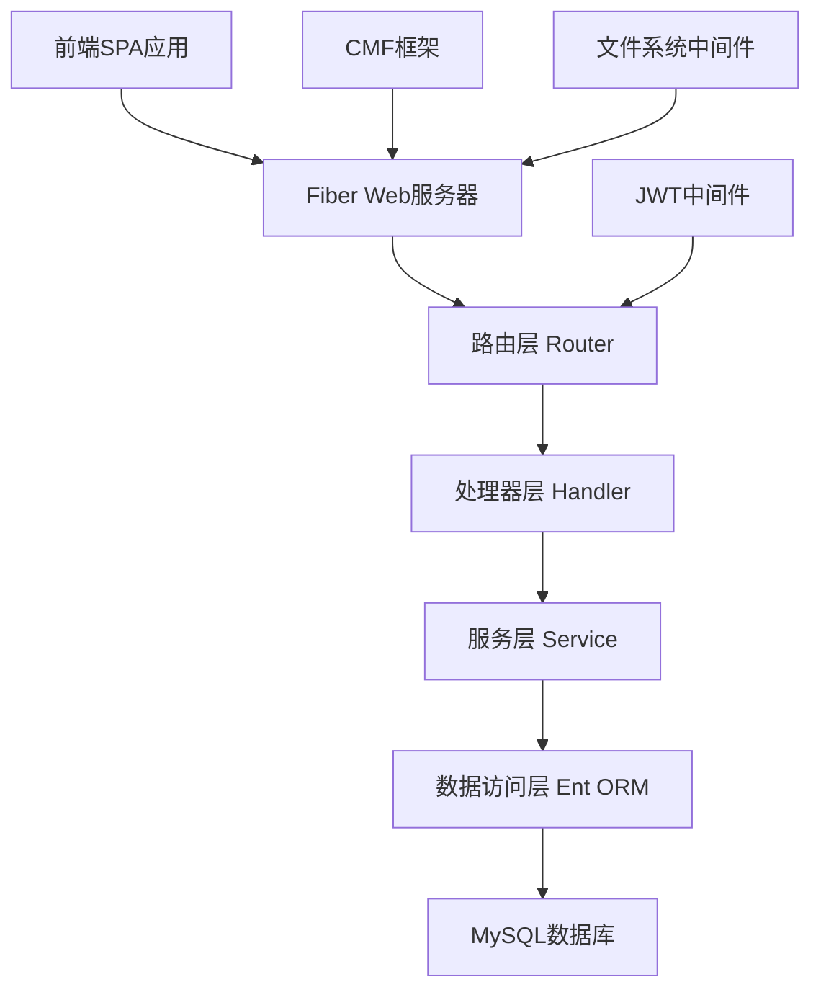

# Go-Admin

一个基于Go语言的现代化管理后台API系统，采用Fiber Web框架、Ent ORM和自定义CMF框架构建。

## 🚀 特性

- **高性能**: 基于Fiber框架，提供出色的性能表现
- **类型安全**: 使用Ent ORM确保数据库操作的类型安全
- **现代架构**: 采用分层架构设计，易于维护和扩展
- **JWT认证**: 内置JWT认证机制，保障API安全
- **权限控制**: 集成Casbin权限管理框架
- **缓存支持**: 支持内存缓存和Redis缓存
- **文件存储**: 支持本地存储和S3兼容的云存储
- **前端集成**: 内嵌前端SPA应用，支持单页面应用路由
- **配置管理**: 灵活的YAML配置文件管理
- **日志系统**: 完善的日志记录和轮转机制

## 📋 技术栈

### 后端框架
- **[Fiber](https://github.com/gofiber/fiber)** v3.2.0 - 高性能HTTP Web框架
- **[Ent](https://entgo.io/)** v0.14.5 - 类型安全的ORM框架
- **CMF** v0.0.0 - 自定义基础框架

### 数据库和缓存
- **MySQL** 5.7+ / 8.0+ - 主数据库
- **Redis** 5.0+ - 缓存和会话存储

### 认证和权限
- **JWT** - JSON Web Token认证 (golang-jwt/jwt v5.3.1)
- **Casbin** v3.10.0 - 基于RBAC的权限控制
- **bcrypt** - 密码加密算法

### Casbin v3 升级说明
- Casbin 已从 `github.com/casbin/casbin/v2` 升级到 `github.com/casbin/casbin/v3 v3.10.0`。
- v3 迁移核心变更为 Go module import path 从 `/v2` 切换到 `/v3`，现有 Enforcer API、Adapter 接口和模型语法保持兼容。
- `config/config.yml` 中的带域 RBAC 模型无需调整，仍使用 `sub, dom, obj, act`。
- 本地 CMF 依赖已同步升级到 Casbin v3，并移除仍依赖 Casbin v2 的 `github.com/gofiber/contrib/v3/casbin` 封装。

### 开发和测试工具
- **Go** 1.25.1+ - 编程语言
- **Go Modules** - 依赖管理
- **Swag** v1.16.4 - Swagger 文档生成（`swag init`）
- **golangci-lint** - 代码质量检查

## 🏗️ 项目结构

```
go-admin/
├── main.go                 # 应用入口
├── go.mod                  # Go模块定义
├── .golangci.yml           # 代码质量检查配置
├── config/
│   └── config.yml          # 配置文件
├── internal/               # 内部包
│   ├── init.go             # 初始化逻辑
│   ├── router.go           # 路由定义
│   ├── cleanup.go          # 清理逻辑
│   ├── middleware/         # 中间件（JWT、权限、黑名单等）
│   ├── handler/            # HTTP处理器
│   ├── service/            # 业务逻辑层
│   ├── ent/                # Ent ORM生成代码
│   │   └── schema/         # 数据模型定义
│   ├── global/             # 全局变量和常量
│   ├── captcha/            # 验证码
│   ├── casbin/             # Casbin权限
│   ├── cron/               # 定时任务
│   ├── oauth/              # OAuth登录
│   ├── plugin/             # 插件系统
│   ├── sse/                # SSE推送
│   ├── tasks/              # 后台任务注册
│   └── utils/              # 工具函数
├── cmd/                    # 辅助命令（captcha-reencrypt 等）
├── web/dist/               # 内嵌前端构建产物（go:embed）
├── data/                   # 运行时数据（日志、文件存储）
└── docs/                   # 项目文档与API规范
```

## 🚀 快速开始

### 环境要求

- Go 1.25.1 或更高版本
- MySQL 5.7+ 或 MySQL 8.0+
- Redis 5.0+ (可选，用于缓存)

### 安装步骤

1. **克隆项目**
   ```bash
   git clone <repository-url> go-admin
   cd go-admin
   ```

2. **安装依赖**
   ```bash
   go mod download
   ```

3. **准备数据库**
   ```sql
   CREATE DATABASE go_admin CHARACTER SET utf8mb4 COLLATE utf8mb4_unicode_ci;
   ```

4. **配置应用**
   ```bash
   # 编辑配置文件
   vim config/config.yml
   
   # 修改数据库连接信息
   database:
     connections:
       default:
         host: localhost
         port: 3306
         user: your_username
         password: your_password
         name: go_admin
   ```

5. **构建并运行**
   ```bash
   # 构建应用
   go build -o go-admin main.go
   
   # 运行应用
   ./go-admin
   ```

6. **访问应用**
   - 前端界面: http://localhost:9501
   - API接口: http://localhost:9501/api/v1

## 📖 API文档

API 规范由 [Swag](https://github.com/swaggo/swag) 注解生成，产物为 `docs/swagger.json`（`docs/swagger.yaml`、`docs/docs.go` 同步生成）。修改接口后执行 `swag init -g main.go -o docs` 重新生成。

Swagger UI 默认关闭（安全基线：无需认证即可查看全部 API）。在隔离的本地开发环境将 `app.swagger` 设为 `true`（或开启 `app.debug`）后，访问 `http://localhost:9501/docs` 查看。

### 公开接口

#### 用户登录
```http
POST /api/v1/public/login
Content-Type: application/json

{
  "email": "user@example.com",
  "password": "password123"
}
```

**响应示例**:
```json
{
  "code": 200,
  "message": "success",
  "data": {
    "access_token": "eyJhbGciOiJIUzI1NiIsInR5cCI6IkpXVCJ9...",
    "token_type": "Bearer",
    "expires_in": 86400,
    "refresh_token": "..."
  }
}
```

为满足等保要求，登录也支持 RSA 加密传输：先请求 `GET /api/v1/public/public-key` 获取公钥，再以 `encrypted_email` / `encrypted_password` 搭配 `timestamp` / `nonce` / `key_id` 提交。刷新令牌使用 `POST /api/v1/public/refresh-token`；管理端登录与刷新分别为 `POST /api/v1/admin/public/login` 和 `POST /api/v1/admin/public/refresh`。

### 受保护的接口

所有 `/api/v1/admin/auth/*` 路径下的接口都需要JWT认证。

#### 获取用户信息
```http
GET /api/v1/admin/auth/user
Authorization: Bearer <jwt_token>
```

#### 更新用户信息
```http
PUT /api/v1/admin/auth/user
Authorization: Bearer <jwt_token>
Content-Type: application/json

{
  "nickname": "新昵称",
  "phone": "13800138000",
  "avatar": "https://example.com/avatar.jpg"
}
```

#### 修改密码
```http
PUT /api/v1/admin/auth/password
Authorization: Bearer <jwt_token>
Content-Type: application/json

{
  "old_password": "old_password123",
  "new_password": "new_password123"
}
```

## ⚙️ 配置说明

### 应用配置
```yaml
app:
  name: admin-api            # 应用名称
  port: 9501                 # 监听端口
  debug: false               # 调试模式（开启会同时启用 Swagger UI）
  swagger: false             # Swagger UI 开关（生产环境必须保持关闭）
  secret: ""                 # JWT 用户端密钥：留空时启动自动生成随机密钥
  admin_secret: ""           # JWT 管理端密钥：留空时启动自动生成随机密钥
  login_expires: 86400       # JWT 用户端过期时间 (秒)
  admin_login_expires: 7200  # JWT 管理端过期时间 (秒)
```

> 生产环境必须通过环境变量设置强密钥，避免重启后随机轮换导致全员 token 失效：
> `CMF_APP_SECRET`（用户端）与 `CMF_APP_ADMIN_SECRET`（管理端）。

### 数据库配置
```yaml
database:
  default: default
  connections:
    default:
      driver: mysql
      host: localhost
      port: 3306
      user: root
      password: root
      name: go_admin
      table_prefix: admin_
```

### 缓存配置
```yaml
cache:
  default: memory         # 默认使用内存缓存
  stores:
    memory:
      driver: memory
      default_ttl: 3600
    redis:
      driver: redis       # 可选择Redis缓存
      default_ttl: 3600
```

### 附件存储（S3 / MinIO）

默认磁盘为 S3。本地开发用一条命令启动 MinIO 并初始化桶（`public/` 前缀匿名可读，私有附件走预签名 URL）：

```bash
docker compose -f docker-compose.minio.yml up -d
```

```yaml
filesystem:
  default: s3
  is_and_local: false
  disks:
    local:
      driver: local
      options:
        root: ./data/storage
        public_base_url: /uploads
    s3:
      driver: s3
      options:
        access_key: minioadmin
        secret_key: minioadmin
        region: us-east-1
        bucket: admin-attachments
        endpoint: http://127.0.0.1:9000
        public_base_url: http://127.0.0.1:9000/admin-attachments
        use_path_style: true
```

- 生产环境必须通过 `CMF_FILESYSTEM_DISKS_S3_OPTIONS_ACCESS_KEY` / `..._SECRET_KEY` 注入密钥。
- `/uploads` 静态目录由 `local.options.root` 推导为 `<root>/public`；默认磁盘切到 S3 后仍可访问历史本地附件。
- 附件记录按自身 `disk` 字段读写，local / s3 可混存；无磁盘信息的历史记录按本地文件处理。
- `public/` 前缀附件返回 `public_base_url` 直链，其余附件返回预签名 URL。

### 验证码配置

```yaml
captcha:
  store: memory              # 多实例或 prefork 必须改为 redis
  redis_connection: redis
  key_prefix: captcha
```

Provider 密钥使用 AES-256-GCM 加密后存入 `system_config`。环境主密钥不进入数据库：

```text
CMF_CONFIG_SECRET_ACTIVE_VERSION=v1
CMF_CONFIG_SECRET_KEY_V1=<32字节密钥的Base64>
```

登录场景初始关闭。前端接入流程为：

1. `POST /api/v1/public/captcha/challenges` 创建挑战。
2. `POST /api/v1/public/captcha/verifications` 换取一次性票据。
3. 登录或表单请求通过 `X-Captcha-Token` 携带票据。

轮换环境主密钥后执行：

```bash
go run ./cmd/captcha-reencrypt --dry-run=true
go run ./cmd/captcha-reencrypt --dry-run=false
```

更多配置选项请参考 [config/config.yml](config/config.yml)，文件内含逐项注释说明。

## 🏛️ 架构设计

### 分层架构



### 核心组件

- **路由层**: 负责HTTP请求路由和中间件管理
- **处理器层**: 处理HTTP请求和响应
- **服务层**: 实现业务逻辑
- **数据访问层**: 使用Ent ORM进行数据库操作
- **中间件**: JWT认证、文件服务、日志记录等

## 🗄️ 数据库设计

### 用户表 (User)
| 字段 | 类型 | 说明 |
|------|------|------|
| id | INT | 主键，自增 |
| email | VARCHAR(255) | 邮箱地址，唯一 |
| password | VARCHAR(255) | 加密密码 |
| name | VARCHAR(255) | 用户姓名 |
| username | VARCHAR(255) | 用户名 |
| nickname | VARCHAR(255) | 昵称 |
| uid | VARCHAR(255) | 用户唯一标识 |
| password_salt | VARCHAR(255) | 密码盐值 |
| avatar | VARCHAR(1024) | 用户头像 |
| phone | VARCHAR(20) | 手机号码 |
| status | ENUM | 用户状态 (active/inactive/suspended) |
| last_login | TIMESTAMP | 最后登录时间 |
| last_ip | VARCHAR(50) | 最后登录IP |
| create_time | TIMESTAMP | 创建时间 |
| update_time | TIMESTAMP | 更新时间 |

### 权限规则表 (CasbinRule)
用于存储Casbin权限控制规则，支持RBAC权限模型。

数据模型以 Ent schema 为准，见 `internal/ent/schema/`。

## 🛠️ 开发指南

### 开发环境搭建

1. **安装Go开发工具**
   ```bash
   go install golang.org/x/tools/cmd/goimports@latest
   go install github.com/golangci/golangci-lint/cmd/golangci-lint@latest
   go install entgo.io/ent/cmd/ent@latest
   ```

2. **启动开发服务**
   ```bash
   # 开发模式运行
   go run main.go
   
   # 或使用热重载工具
   go install github.com/cosmtrek/air@latest
   air
   ```

### 添加新功能

源码功能集可在 `internal/apps/<code>/` 同时声明配置、字典、路由、权限和 Ent 模型。参见[源码功能集开发说明](docs/source-apps.md)；新增功能集后先运行 `go generate ./internal/apps`，再运行 `go generate ./internal/ent`。

1. **定义数据模型** (如需要)
   在 `internal/ent/schema/` 下新增或修改 schema，然后重新生成代码：
   ```bash
   go generate ./internal/ent
   ```

2. **实现业务逻辑**
   - 在 `internal/service/` 中添加服务层代码
   - 在 `internal/handler/` 中添加处理器代码

3. **注册路由**
   - 在 `internal/router.go` 中添加新的路由

4. **运行测试**
   ```bash
   go test ./...
   ```

## 🧪 测试

### 运行测试
```bash
# 运行所有测试
go test ./...

# 运行测试并显示覆盖率
go test -cover ./...

# 生成覆盖率报告
go test -coverprofile=coverage.out ./...
go tool cover -html=coverage.out -o coverage.html
```

### 代码质量检查
```bash
# 运行代码质量检查
golangci-lint run

# 自动修复可修复的问题
golangci-lint run --fix
```

### 测试结构
- **单元测试**: 测试单个函数和方法
- **集成测试**: 测试API端点和数据库交互
- **性能测试**: 使用基准测试评估性能
- **代码质量**: 使用golangci-lint进行静态分析

## 🚀 部署

### 生产环境部署

1. **构建生产版本**
   ```bash
   CGO_ENABLED=0 GOOS=linux go build -a -installsuffix cgo -ldflags '-w -s' -o go-admin main.go
   ```

2. **配置systemd服务**
   ```bash
   sudo systemctl enable go-admin
   sudo systemctl start go-admin
   ```

3. **配置反向代理**
   - 使用Nginx或Apache作为反向代理
   - 配置SSL证书
   - 设置负载均衡 (如需要)

## 📊 监控和运维

### 健康检查
- `GET /` 返回内嵌的前端 SPA 首页，可确认服务与静态资源正常。
- 项目未提供专门的 JSON 健康检查端点；API 可用性可通过公开接口 `GET /api/v1/public/public-key` 探测。

### 日志管理
```bash
# 查看应用日志
tail -f ./data/logs/admin-api.log

# 查看系统服务日志
sudo journalctl -u go-admin -f
```

### 性能监控
- CPU使用率监控
- 内存使用监控
- 数据库连接池监控
- API响应时间监控

## 🔒 安全特性

- **JWT认证**: 保护API端点安全
- **密码加密**: 使用bcrypt加密用户密码
- **SQL注入防护**: Ent ORM提供类型安全的查询
- **CORS支持**: 配置跨域资源共享
- **权限控制**: 基于Casbin的RBAC权限管理
- **敏感数据保护**: 敏感字段自动隐藏

## 🤝 贡献指南

我们欢迎所有形式的贡献！

### 贡献方式
1. Fork 项目
2. 创建功能分支 (`git checkout -b feature/AmazingFeature`)
3. 提交更改 (`git commit -m 'Add some AmazingFeature'`)
4. 推送到分支 (`git push origin feature/AmazingFeature`)
5. 创建 Pull Request

### 代码规范
- 遵循Go官方代码规范
- 使用 `gofmt` 格式化代码
- 添加必要的注释和文档
- 编写单元测试

### 提交信息规范
```
<type>(<scope>): <subject>

feat: 新功能
fix: 修复bug
docs: 文档更新
style: 代码格式调整
refactor: 代码重构
test: 测试相关
```

## 📄 许可证

本项目采用 [MIT License](LICENSE) 许可证。

## 🙏 致谢

感谢以下开源项目的支持：

- [Fiber](https://github.com/gofiber/fiber) - 高性能Web框架
- [Ent](https://entgo.io/) - 类型安全的ORM
- [Casbin](https://github.com/casbin/casbin) - 权限管理框架
- [JWT-Go](https://github.com/golang-jwt/jwt) - JWT实现
- [Viper](https://github.com/spf13/viper) - 配置管理

## 📚 相关文档

- [📖 文档导航](docs/README.md) - 完整文档索引
- [🔐 GitHub OAuth 接入](docs/oauth-github.md) - OAuth 配置与绑定流程
- [📋 API 规范](docs/swagger.json) - Swag 生成的 OpenAPI 2.0 规范（Swagger UI 见上文「API文档」）
- [🧭 AGENTS.md](AGENTS.md) - 仓库协作规范与常用命令

---

**Go-Admin** - 让管理后台开发更简单 🚀
